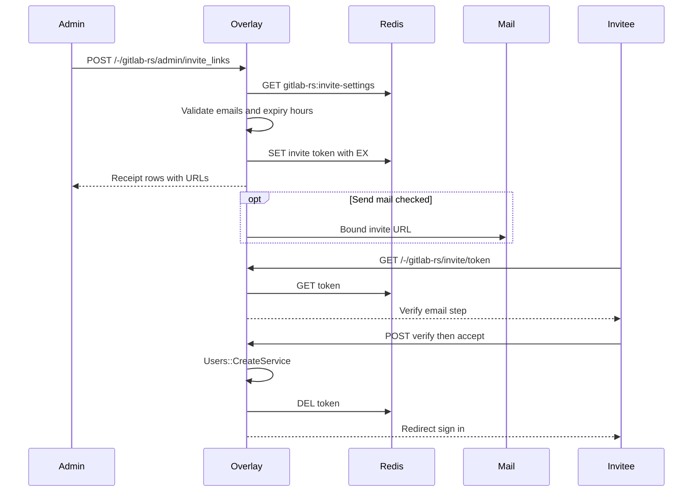

# Admin One-Time Invite Link

Feature Name: admin-one-time-invite-link
Updated: 2026-11-15

## Description

管理员在「新用户」页生成一次性邀请。支持匿名链接与绑定邮箱链接，二者都要校验邮箱可用。生成时填写 1 至 720 的过期小时数，缺省 24。批量不设条数上限，返回逐条回执。绑定邀请默认发信。邮箱域名白名单嵌在官方 Admin Settings 注册设置中，默认关闭。令牌与设置均存 Redis，不新增 SQL migration。

## Architecture

## Components and Interfaces

现有 overlay 继续承载全部逻辑。

- `docker/gitlab-rails-overrides/config/initializers/gitlab_rs_invite_links.rb`：令牌、邮箱校验、批量 create、设置读写、公开注册
- `docker/gitlab-rails-overrides/public/gitlab-rs-invite-link.js`：弹层增加过期小时、匿名条数、邮箱列表、是否发信、回执表
- `docker/gitlab-rails-overrides/app/views/gitlab_rs/invite_links/show.html.haml`：绑定邀请第一步邮箱只读
- `docker/gitlab-rails-overrides/app/views/admin/application_settings/_signup.html.haml`：在官方注册设置中增加白名单开关与域名列表
- `scripts/cleanup-gitlab-rs-overlay.sh`：继续清理 Redis `gitlab-rs:*`，覆盖令牌与设置

管理员 API：

- `POST /-/gitlab-rs/admin/invite_links`：单条或批量。JSON 字段 `access_level`、`external`、`expiry_hours`、`emails`、`anonymous_count`、`send_email`
- 白名单随官方 `Admin::ApplicationSettingsController#update` 一并提交。initializer prepend 该 action，把开关与域名写入 Redis，不改 `application_settings` 表
- overlay `_signup.html.haml` 从 GitLab 19.3.6 对应模板扩展，增加「邀请邮箱白名单」区块；表单字段名 `gitlab_rs_invite_allowlist_enabled`、`gitlab_rs_invite_allowlist_domains`

公开路径保持 `GET/POST /-/gitlab-rs/invite/:token` 与 `/email`、`/verify`。

弹层「发送邀请邮件」默认勾选。`send_email` 缺省为 true。

批量不设条数上限。匿名条数为非负整数，电子邮件列表按行解析后逐条处理。

## Data Models

Redis `gitlab-rs:invite-link:<token>` JSON：

- 既有：`access_level`、`external`、`can_create_group`、`private_profile`、`projects_limit`、`created_by_id`、`organization_id`、`pending_email`、`email_code`、`email_code_sent_at`、`verified_email`
- 新增：`bound_email`（绑定邀请为规范化小写地址，匿名邀请缺省该字段）

令牌 TTL = `expiry_hours * 3600` 秒。

Redis `gitlab-rs:invite-settings` JSON：

- `allowlist_enabled`：布尔，默认 false
- `allowlist_domains`：小写域名数组，如 `example.com`

批量回执 JSON：`items` 数组，每项含 `kind`（anonymous 或 bound）、`email`、`url`、`status`（created 或 skipped）、`reason`、`mailed`。

## Correctness Properties

- 匿名邀请允许受邀者填写邮箱；绑定邀请验证步使用 `bound_email`，请求体中的其它地址无效
- 邮箱校验顺序：格式 → 占用 → 白名单（仅开启时）
- 白名单匹配电子邮件 `@` 后的完整域名，大小写不敏感
- 批量失败项跳过，成功项照常签发；回执覆盖每一输入行与每一条匿名链接
- `send_email` 只对 `status=created` 的绑定邀请生效；发信失败时回执 `mailed=false` 且 `reason` 记录发信失败，令牌保留
- `send_email` 缺省 true；管理员可取消勾选
- 过期由 Redis `EX` 执行；过期后读写均视为无效邀请

## Error Handling

- `expiry_hours` 非 1–720 整数：整次请求 422
- 匿名条数与邮箱列表都为空：422
- 单条邮箱格式错误、已占用、不在白名单：该行 skipped，原因写入回执
- 绑定邀请打开后提交与 `bound_email` 不同的地址：422，令牌保留
- 白名单保存走官方 Admin Settings 权限；非管理员无法打开该页

## Test Strategy

在 9071 金丝雀验证，9061 不动。

- 缺省过期生成后 Redis TTL 约 86400 秒
- `expiry_hours=2` 时 TTL 约 7200 秒；`0` 与 `721` 返回 422
- 批量：2 个合法邮箱 + 1 条匿名 + 1 个已占用邮箱 → 回执 3 成功 1 跳过
- 绑定邀请验证步无法改邮箱；匿名邀请可填
- 白名单关闭时公共域名可通过；开启后仅名单内域名通过
- `send_email=true` 时回执 `mailed` 与实际投递一致
- 清理脚本删除 `gitlab-rs:invite-settings` 与令牌键

## References

[^1]: (Filename) - invite initializer `docker/gitlab-rails-overrides/config/initializers/gitlab_rs_invite_links.rb`
[^2]: (Filename) - admin users form overlay `docker/gitlab-rails-overrides/app/views/admin/users/_form.html.haml`
[^3]: (Filename) - invite modal JS `docker/gitlab-rails-overrides/public/gitlab-rs-invite-link.js`
[^4]: (Filename) - signup settings overlay `docker/gitlab-rails-overrides/app/views/admin/application_settings/_signup.html.haml`
