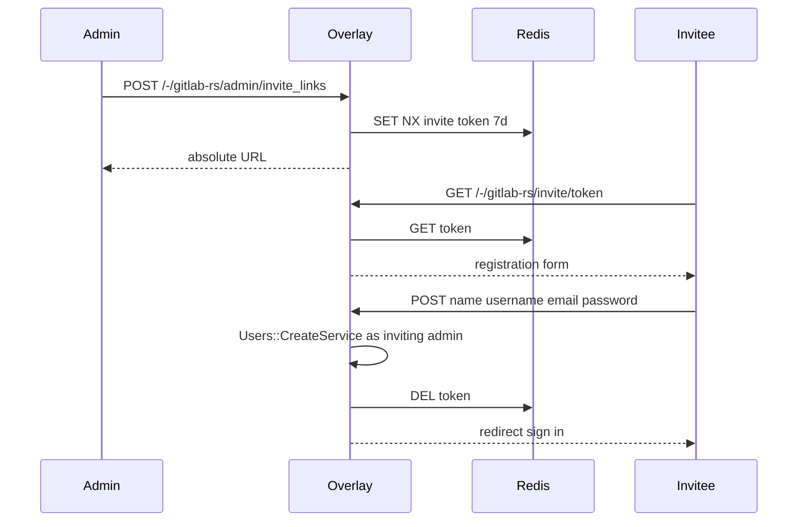

# Admin One-Time Invite Link

Feature Name: admin-one-time-invite-link
Updated: 2026-11-11

## Description

在官方「新用户」表单的帐户标题旁注入按钮。管理员预置 Regular/Administrator 与 External 后生成链接。受邀者访问 `/-/gitlab-rs/invite/:token` 自行注册。令牌存 Redis，不新增 migration。

## Architecture

## Components and Interfaces

- Rails initializer `gitlab_rs_invite_links.rb`：middleware 分发、管理员 JSON 创建、公开注册
- Overlay `_form.html.haml`：帐户标题旁按钮
- `public/gitlab-rs-invite-link.js`：弹层、生成、复制
- `app/views/gitlab_rs/invite_links/show.html.haml`：注册页

## Data Models

Redis `gitlab-rs:invite-link:<token>` JSON：access_level、external、projects_limit、can_create_group、created_by_id、organization_id。TTL 604800 秒。

## Correctness Properties

- 令牌一次性：创建用户成功后删除
- 表单校验失败保留令牌
- 非管理员无法生成

## Error Handling

- 无效令牌：404 文案
- 创建失败：表单回显错误

## Test Strategy

9071 金丝雀：新用户页按钮可见；管理员生成链接；用链接注册后旧链接失效；9061 不动。

## References

[^1]: (Filename) - admin users form overlay `docker/gitlab-rails-overrides/app/views/admin/users/_form.html.haml`
