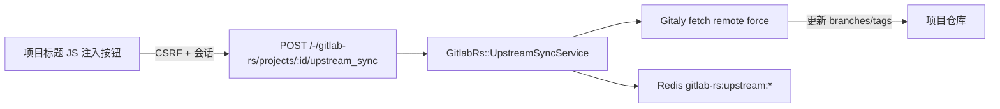

# 导入项目上游同步

Feature Name: imported-project-upstream-sync
Updated: 2026-11-19

## Description

在导入项目的标题旁加入 Gitee 风格的强制同步按钮。点击后从导入时记录的上游 Git 地址拉取全部 refs，并用上游覆盖本仓库同名分支与标签。实现走 gitlab-rs overlay：initializer + 中间件/API + 页头 JS，对齐压缩历史与邀请链接的 drop-in 方式。

默认行为对齐截图：按钮在 `奸商 / index-tts1.5` 标题右侧；tooltip 为「点击从 https://github.com/toarujs/index-tts.git 强制同步。」

## Architecture

导入完成时，Import 相关服务被 prepend：把来源 URL 写入 Redis `gitlab-rs:upstream:{project_id}`，并在 `import_url` 仍可用时同时读取它。页面渲染时 initializer 向 `gon` 或 mount 节点提供 `upstream_url`、`can_sync`。

## Components and Interfaces

### 1. 页头按钮

- 文件：`docker/gitlab-rails-overrides/public/gitlab-rs-upstream-sync.js`
- 挂载：项目布局或 `projects/show` 注入空节点（压缩历史同款 `#js-gitlab-rs-*` + `javascript_tag`）
- 定位：在项目标题/breadcrumb 名称右侧插入圆形刷新按钮，避免改 Vue 源码
- 展示条件：`upstreamUrl` 非空且当前用户为 Owner（`can?(:owner_access, project)` / `:remove_project`）
- 交互：点击 POST；进行中禁用并旋转图标；结束 toast/横幅；失败展示服务端 message

### 2. 同步入口

- 路径：`POST /-/gitlab-rs/projects/:id/upstream_sync`
- 鉴权：登录 + `can?(user, :owner_access, project)`（仅 Owner）
- CSRF：沿用会话 CSRF，与压缩历史一致
- 响应：
  - `202 { status: "started" }`
  - `409 { status: "running" }` 已有租约
  - `403/404/422` 权限、缺失上游、参数错误
- 可选查询：`GET /-/gitlab-rs/projects/:id/upstream_sync` 返回当前 job 状态，供按钮轮询

### 3. GitlabRs::UpstreamSyncService

同步步骤：

1. 读取 Upstream URL（Redis 优先，回退 `project.import_url`）
2. 取 Redis 租约 `gitlab-rs:upstream-lock:{project_id}`，TTL 10 分钟
3. 组装 fetch URL：若 `project.import_data` 仍有用户名/token，写入 URL 用户信息
4. 调用 Gitaly/仓库 API 强制抓取远程 refs（目标等价 `git fetch --force --prune --tags <upstream> '+refs/heads/*:refs/heads/*' '+refs/tags/*:refs/tags/*'`）
5. 使 commit/branch/tag 缓存失效
6. 写 job 结果到 Redis，释放租约

优先使用 CE 已有 `Repository#fetch_remote` / `fetch_as_mirror(url, forced: true)`。若当前 19.3.6 FOSS 无 `fetch_as_mirror`，则走 `gitaly git fetch`（压缩历史已用 `gitaly git -c config.toml --git-dir=...`）。

### 4. 上游地址持久化

导入成功后保存，避免 CE 导入器清理 `import_url`：

- Redis：`gitlab-rs:upstream:{project_id}` -> `{ "url": "...", "import_type": "github|git|gitee" }`，无 TTL
- 读取顺序：Redis -> `project.import_url` -> 不显示按钮
- 清理：扩展 `scripts/cleanup-gitlab-rs-overlay.sh` 已有 `gitlab-rs:*` 扫描，覆盖本键

不新增 Postgres migration，保持官方 CE 切回只改镜像名。

## Data Models

Redis 键：

- `gitlab-rs:upstream:{project_id}`：上游元数据 JSON
- `gitlab-rs:upstream-lock:{project_id}`：互斥租约
- `gitlab-rs:upstream-job:{project_id}`：最近一次 job `{status, started_at, finished_at, error, operator_id}`

不改 `projects` 表结构。凭据只使用 GitLab 已保存的 `import_data`，响应与日志中的 URL 去掉 userinfo。

## Correctness Properties

- 无 Upstream URL 时标题区与库存 UI 一致
- 非 Owner 看不到按钮，POST 返回 403
- 同一项目同一时刻只有一个 Sync job
- Force sync 以 upstream 的同名 ref 为准；仅存在于本仓库的 ref 保留
- tooltip 与错误文案中的 URL 不含密码或 token
- overlay 数据可用现有 `gitlab-rs:*` 清理脚本删除

## Error Handling

| 场景 | 处理 |
|------|------|
| 上游 DNS/超时/401 | job 失败，按钮恢复，展示「无法访问上游」或「认证失败」 |
| 仓库为空或 Gitaly 不可用 | 422/500，展示失败原因 |
| 租约占用 | 409，按钮保持进行中并继续轮询 |
| 受保护分支拒绝更新 | 将失败原因返回；后续可评估以站点管理员身份绕过 hooks |
| 上游为私有且 import_data 无凭据 | 422，提示重新导入或在上游改公开后再同步 |

LFS 对象、Wiki、Package 不在本功能范围内。

## Test Strategy

- initializer 单测：有/无 upstream、权限开关、URL 脱敏
- service：mock Gitaly fetch；租约冲突；凭据拼进 URL
- 请求：未登录 401、Maintainer/Developer 403、Owner 202
- 9071 手工：导入 `https://github.com/toarujs/index-tts.git`，标题旁出现按钮，点击后分支/tag 与 GitHub 对齐
- 回归：无 import_url 的自建项目标题不变

## Implementation Plan

1. 确认 19.3.6 CE 中 `Repository#fetch_remote` / `fetch_as_mirror` 与 `import_url` 在导入结束后是否仍在
2. 写 `gitlab_rs_upstream_sync.rb`：持久化、Service、Middleware、Controller
3. 写 `gitlab-rs-upstream-sync.js`：插按钮、tooltip、轮询
4. 在项目页 HAML 挂载节点（标题旁或 layout）
5. 扩展 cleanup 说明；zh_CN 文案进 overlay po
6. 9071 用公开 GitHub 仓验收后再考虑 9061

## Locked Decisions

- 同步策略：强制覆盖同名分支/标签
- 权限：仅 Owner
- 私有上游：只复用导入凭据，第一版不提供填 Token 的表单
- 执行：请求内启动、Redis 租约；超长仓库若超时再改 Sidekiq

## References

- 用户截图：Gitee 项目 `奸商/index-tts1.5` 标题旁同步按钮，tooltip「点击从 https://github.com/toarujs/index-tts.git 强制同步。」
- 压缩历史 overlay：`docker/gitlab-rails-overrides/config/initializers/gitlab_rs_compress_history.rb`
- 压缩历史挂载：`docker/gitlab-rails-overrides/app/views/projects/_compress_history_mount.html.haml`
- 邀请 overlay 中间件模式：`docker/gitlab-rails-overrides/config/initializers/gitlab_rs_invite_links.rb`
- Overlay 清理：`scripts/cleanup-gitlab-rs-overlay.sh`
